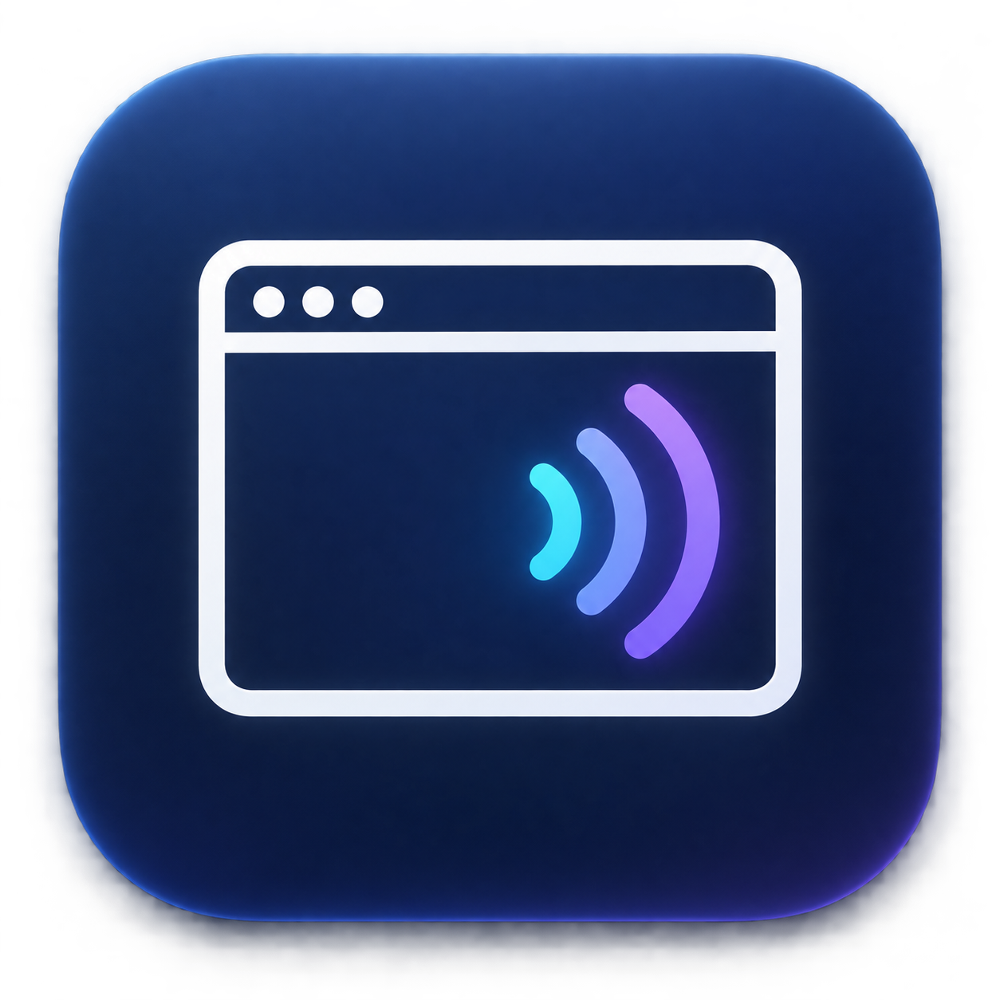

# Siri Flow Guard



On the macOS 27 Siri beta, opening a conversation or sending a message can bring Wispr Flow's Hub to the front. This happened on our two-monitor setup even when Flow's Hub was closed and Siri still had keyboard focus.

## What causes it

Siri asks `intelligencecontextd` for on-screen context. Flow keeps a `Status` utility window on screen even after its Hub is closed. In the failing sequence, the context service selected Flow, requested a background App Intents connection, and macOS sent the already-running Flow process an `aevt/rapp` reopen event. Flow's Electron activation handler then showed the Hub. A typed Siri message reproduced the issue without using Flow's dictation shortcut.

## What the guard does

The guard runs outside both apps. Before a mouse click in Siri or a Return keypress reaches Siri, it briefly hides Flow so its `Status` window is absent from the context snapshot. It forwards the original input unchanged. Flow is restored after a short interval, or before the next key, modifier, Dock, or Flow interaction. This lets Flow's dictation shortcut keep working in Siri.

Rapid changes to Siri's chat list sometimes make Accessibility hit testing fail. The guard also checks the window under the pointer, ignoring Flow's known `Status` overlay, so it can recognize those clicks. It leaves an already-open Hub or an intentionally hidden Flow alone.

## Install

The script builds a small local macOS app and installs a per-user LaunchAgent. The LaunchAgent starts at login and restarts the guard if it exits unexpectedly. It does not modify Siri or Wispr Flow.

Requirements: macOS with the dedicated Siri beta app, Wispr Flow, and Xcode Command Line Tools (`xcode-select --install` if needed).

```sh
git clone https://github.com/shivexe/siri-flow-guard.git
cd siri-flow-guard
./guard.sh build
```

In **System Settings → Privacy & Security**, add `Siri Flow Guard.app` from this cloned folder to **Accessibility**, **Input Monitoring**, and **Screen & System Audio Recording**, and enable each switch. macOS treats this login service separately from Terminal, so Terminal's existing permissions do not cover it. The guard uses Screen Recording access to read window names; it does not save screenshots.

Then run:

```sh
./guard.sh start
./guard.sh status
```

`start` enables startup at login and keeps one guard instance running. `status` reports the guard process, event tap, and Flow window state. `stop` shuts down the guard, restores any temporary hide, and disables startup at login:

```sh
./guard.sh stop
```

If you rebuild or move the app, macOS may ask you to remove and re-add it in those permission lists because a locally built app's code signature changes. The diagnostic log is `guard.log`. Generated files and logs stay local and are excluded from Git.

## Scope

We checked rapid Siri chat switching, typed Return, Flow dictation in and outside Siri, deliberate Dock opening, Flow restart, and guard stop/restart on macOS 27.0 (26A428) with Flow 1.6.897. The guard observes event types and window metadata; it does not store typed text, audio, or conversation content.

This is a workaround for the verified Siri and Flow interaction. If hiding Flow takes more than 60 ms, the guard passes the input and restores Flow. Other Siri entry paths and future beta versions may need changes. The underlying background reopen behavior needs an Apple-level fix.
